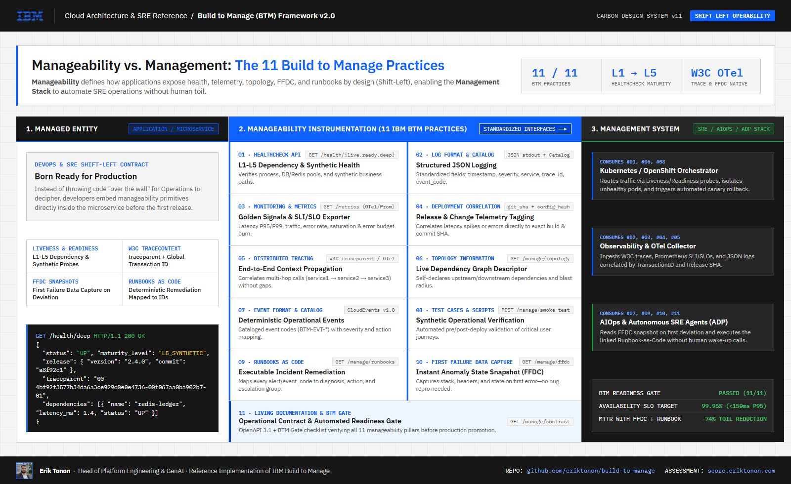
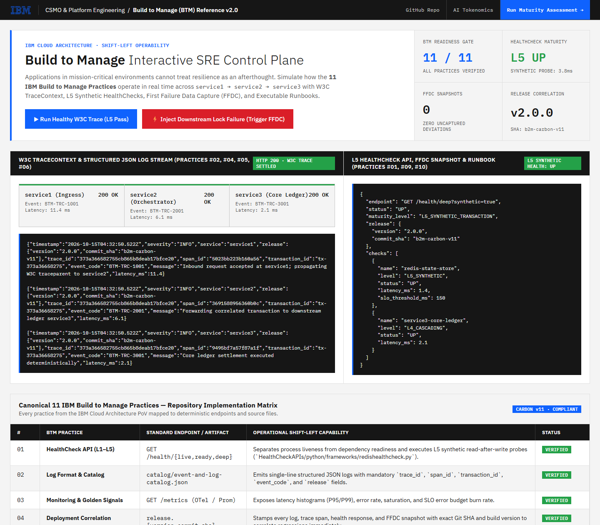

# Build to Manage (BTM) Framework v2.0 — IBM Cloud Architecture & SRE Reference

[](https://carbondesignsystem.com/)
[](#the-11-canonical-build-to-manage-practices)
[](DistributedTrace/python/)
[](https://score.eriktonon.com)

> **Shift-Left Operability for Mission-Critical Systems**: Applications must not merely compile and pass functional tests—they must be **born ready to be managed, observed, diagnosed, and self-healed in production**.



---

## 1. Executive Summary: Why Build to Manage?

We have all seen the classic anti-pattern: Development throws new code "over the wall," and Operations has to figure out in the middle of an incident how to deploy, monitor, correlate, and recover it.

In high-velocity cloud-native and agentic environments (Continuous Delivery, Kubernetes/OpenShift, and high-throughput financial settlement), Operations has zero time to reverse-engineer application behavior after deployment. **Resilience cannot be an afterthought bolted on post-release; it must be a functional acceptance criterion from day one.**

**Build to Manage (BTM)** defines the **11 concrete engineering practices** that developers embed directly inside a microservice (**Manageability**) so that the enterprise **Management Stack** (Kubernetes/OpenShift, OpenTelemetry Collectors, AIOps, and Autonomous SRE Agents) can operate the service deterministically without human toil.

---

## 2. The 11 Canonical Build to Manage Practices

| # | BTM Practice | Standard Interface / Contract | Repository Implementation |
| :---: | :--- | :--- | :--- |
| **01** | **HealthCheck API (L1–L5 Maturity)** | `GET /health/live`<br/>`GET /health/ready`<br/>`GET /health/deep?synthetic=true` | [`HealthCheckAPIs/python/`](HealthCheckAPIs/python/) — Separates process liveness (L1) from backing-store readiness (L3) and synthetic read-after-write business probes (L5). |
| **02** | **Log Format & Catalog** | Structured single-line JSON (`stdout`) | [`catalog/event-and-log-catalog.json`](catalog/event-and-log-catalog.json) — Enforces `timestamp`, `severity`, `service`, `trace_id`, `span_id`, `transaction_id`, and `event_code`. |
| **03** | **Monitoring, Golden Signals & SLOs** | `GET /metrics` (OpenTelemetry / Prometheus) | Latency (P95/P99), traffic, error rate (`5xx`), saturation, and real-time Error Budget burn rate thresholds. |
| **04** | **Deployment Correlation** | `release.version` + `release.commit_sha` | Every log line, trace span, health check, and FFDC snapshot carries the exact Git SHA and release version to isolate bad deploys in seconds. |
| **05** | **Distributed Tracing** | W3C `traceparent` + `X-Global-Transaction-Id` | [`DistributedTrace/python/`](DistributedTrace/python/) — End-to-end context propagation across `service1 → service2 → service3`. |
| **06** | **Topology Information** | `GET /manage/topology` | [`DistributedTrace/python/service1/app.py`](DistributedTrace/python/service1/app.py) — Self-declared upstream/downstream dependency graph and blast radius metadata. |
| **07** | **Event Format & Catalog** | CloudEvents v1.0 (`BTM-*` Event Codes) | [`catalog/event-and-log-catalog.json`](catalog/event-and-log-catalog.json) — Deterministic event codes mapped to SLO impact and escalation squads. |
| **08** | **Test Cases & Synthetic Scripts** | Automated Contract & Smoke Suite | [`tests/test_btm_contracts.py`](tests/test_btm_contracts.py) — Deterministic pre/post-deploy verification of all manageability endpoints. |
| **09** | **Runbooks as Code** | `GET /manage/runbooks` | [`runbooks/RUNBOOK-CATALOG.md`](runbooks/RUNBOOK-CATALOG.md) — Maps every operational alert (`BTM-HC-5001`, `BTM-TRC-5001`) to diagnosis, automated action, and `CAU Group`. |
| **10** | **First Failure Data Capture (FFDC)** | `GET /manage/ffdc` | [`DistributedTrace/python/service1/app.py`](DistributedTrace/python/service1/app.py) — Captures state, headers, and stack snapshot at the exact millisecond of the first failure—eliminating bug reproduction delays. |
| **11** | **Living Documentation & Readiness Gate** | `docs/index.html` + `BTM.png` | [`docs/index.html`](docs/index.html) — Interactive **IBM Carbon Design System v11** SRE Control Plane and 11-pillar readiness verification matrix. |

---

## 3. Interactive SRE Control Plane (IBM Carbon Design System v11)

This repository includes an interactive **Build to Manage Control Plane** built with **IBM Carbon Design System v11** (`IBM Plex Sans`, `IBM Plex Mono`, `IBM Blue 60 #0F62FE`, and `1px` Hairline Grid) located in [`docs/index.html`](docs/index.html).



With the simulator you can:
1. **Trigger a Healthy W3C Trace (`L5 Pass`)**: Watch `traceparent` and `X-Global-Transaction-Id` propagate across `service1 → service2 → service3` with correlated JSON logs.
2. **Inject a Downstream Lock Failure (`?simulate_failure=true`)**: Observe `service3` emit `BTM-LEDGER-5003`, `service1` automatically capture an **FFDC Snapshot (`ffdc-*`)**, and the **Runbook as Code (`BTM-TRC-5001`)** activate for 1-click remediation.

---

## 4. Deep Dive: Key Engineering Patterns

### 4.1 HealthCheck API Maturity Model (L1 to L5)

A superficial `/health` endpoint that always returns `200 OK` while a downstream queue or database pool is dead creates **silent cascading failures**. In [`HealthCheckAPIs/python/frameworks/redishealthcheck.py`](HealthCheckAPIs/python/frameworks/redishealthcheck.py), we implement the 5 IBM maturity levels:

```json
{
  "status": "UP",
  "maturity_level": "L5_SYNTHETIC_TRANSACTION",
  "service": "btm-synthetic-health-service",
  "release": {
    "version": "2.0.0",
    "commit_sha": "b2m-carbon-v11"
  },
  "timestamp": "2026-10-15T12:00:00.000Z",
  "checks": [
    {
      "name": "redis-state-store",
      "level": "L5_SYNTHETIC",
      "status": "UP",
      "latency_ms": 1.42,
      "slo_threshold_ms": 150.0
    }
  ]
}
```

### 4.2 Distributed Tracing (W3C `traceparent`) & First Failure Data Capture (FFDC)

Replacing deprecated OpenTracing libraries, [`DistributedTrace/python/`](DistributedTrace/python/) implements native **W3C TraceContext (`traceparent`)** propagation combined with **FFDC** on the first downstream deviation:

```json
{
  "ffdc_id": "ffdc-9a4c1e02",
  "captured_at": "2026-10-15T12:04:19.112Z",
  "service": "service1",
  "release": {
    "version": "2.0.0",
    "commit_sha": "b2m-carbon-v11"
  },
  "event_code": "BTM-TRC-5001",
  "trace_id": "4bf92f3577b34da6a3ce929d0e0e4736",
  "transaction_id": "tx-4bf92f3577b3",
  "downstream_target": "http://service2:8081/service",
  "error": "Downstream service2 returned HTTP 503",
  "runbook_ref": "/manage/runbooks/BTM-TRC-5001"
}
```

---

## 5. Quickstart (Docker Compose or Local Python 3.12+)

### Run the Complete Topology via Docker Compose
```bash
docker compose up --build
```
- **Interactive IBM Carbon v11 Control Plane**: `http://localhost:8090`
- **Service 1 (Ingress + FFDC + Topology)**: `http://localhost:8080/service`
- **Service 1 Failure & FFDC Simulation**: `http://localhost:8080/service?simulate_failure=true`
- **L5 Synthetic HealthCheck API**: `http://localhost:8083/health/deep?synthetic=true`

### Run Automated Contract & Verification Tests
```bash
pytest tests/test_btm_contracts.py -v
```

---

## 6. Executive Tools & Author

Maintained and modernized by **Erik Tonon** (*Head of Platform Engineering & GenAI · Ex-Associate Director BTG Pactual*).

- 📊 **Platform Engineering & Build to Manage Maturity Assessment (19 Practices)**: [https://score.eriktonon.com](https://score.eriktonon.com)
- 🧮 **Enterprise AI Tokenomics & FinOps Calculator**: [https://tokenomics.eriktonon.com](https://tokenomics.eriktonon.com)
- 🌐 **Executive Portfolio & Architecture Articles**: [https://eriktonon.com](https://eriktonon.com)

---

## License

This project is licensed under the [MIT License](LICENSE.md).
